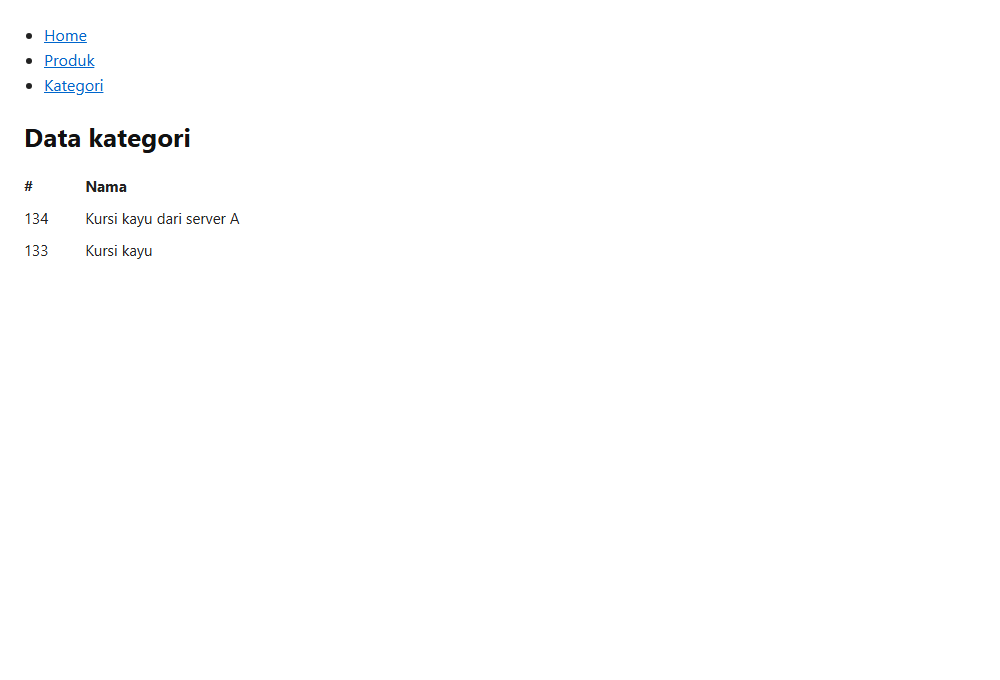

# LAPORAN PRAKTIKUM 11
## IMPLEMENTASI FALLBACK MECHANISM PADA FRONTEND REACT JS
### WORKSHOP PEMROGRAMAN FRAMEWORK - SEMESTER 3

---

## 1. Identitas Mahasiswa & Praktikum
- **Mata Kuliah** : Workshop Pemrograman Framework
- **Modul**       : 11 - Fallback mechanism Frontend React JS
- **Repository**  : [https://github.com/Gaarrr33/UTS-Workshop-Pemrograman-Framework](https://github.com/Gaarrr33/UTS-Workshop-Pemrograman-Framework)
- **Folder Drive**: [Pengumpulan Tugas Laporan Modul 11](https://drive.google.com/drive/folders/1xle5UGmHohmNUAWnGMwy_7jyhSMFjYRQ?usp=sharing)

---

## 2. Tujuan Praktikum
1. Memahami konsep dan arsitektur *Fallback Mechanism* (mekanisme cadangan / *failover*) pada aplikasi berbasis client-side (Frontend React JS).
2. Mampu menerapkan penanganan kegagalan (*error handling*) berbasis *Promise Chaining* dan blok `.catch()` pada Axios untuk mengalihkan *request* ke server cadangan secara mulus (*graceful degradation*).
3. Melakukan pengujian sistem (*testing*) dalam 2 kondisi:
   - **Kondisi 1**: Server Utama aktif merespons (*Normal State*).
   - **Kondisi 2**: Server Utama mati / tidak merespons (*Failover / Fallback State*).
4. Menganalisis keandalan dan integritas data yang diterima oleh komponen antarmuka pengguna (*User Interface*).

---

## 3. Dasar Teori & Arsitektur Solusi

### 3.1 Apa itu Fallback Mechanism?
Dalam arsitektur sistem terdistribusi dan *microservices*, ketergantungan pada satu titik layanan tunggal (*Single Point of Failure* / SPOF) memiliki risiko tinggi terhadap *downtime*. Jika server penyedia data utama mengalami gangguan jaringan, kelebihan beban (*high load*), atau crash fisik, antarmuka pengguna tanpa mekanisme perlindungan akan menampilkan halaman kosong, *loading spinner* tak terhingga, atau pesan kesalahan fatal kepada pengguna (*Bad UX*).

Mekanisme *Fallback* (*Failover*) memungkinkan frontend mendeteksi kegagalan komunikasi HTTP secara otomatis melalui blok *rejection handler* (`catch`), lalu seketika mengarahkan kembali permintaan data ke URL cadangan (*secondary / backup server*) sebelum melempar galat ke layar pengguna.

### 3.2 Diagram Alur Fallback Mechanism
```text
                  +---------------------------+
                  |  Komponen React Kategori  |
                  |     (useEffect Hook)      |
                  +-------------+-------------+
                                |
                    axios.get(serverA :4000)
                                |
                   +------------v------------+
                   | Server A Respon Sukses? |
                   +------------+------------+
                                |
                       +--------+--------+
                    YA |                 | TIDAK (Catch Error)
                       v                 v
          +--------------------+  +----------------------------+
          | setKategori(res)   |  |  axios.get(serverB :3100)  |
          | Data Server Utama  |  +--------------+-------------+
          +--------------------+                 |
                                        +--------v--------+
                                     YA |                 | TIDAK
                                        v                 v
                               +-----------------+  +----------------------+
                               | setKategori(res)|  | console.error()      |
                               | Data Server B   |  | Kedua server gagal   |
                               +-----------------+  +----------------------+
```

---

## 4. Langkah-Langkah Pengerjaan

### 4.1 Menyiapkan Server Utama (Server A)
Server Utama berjalan pada protokol HTTP port `4000` dengan menyediakan endpoint data kategori:
- **URL**: `http://localhost:4000/api/kategori/`
- **File**: `server_utama.js`
- **Kode**:
```javascript
const express = require('express');
const cors = require('cors');

const app = express();
const PORT = 4000;

app.use(cors());
app.use(express.json());

app.get(['/api/kategori', '/api/kategori/'], (req, res) => {
  res.json({
    status: true,
    message: 'Data kategori berhasil diambil dari Server Utama (Port 4000)',
    server: 'Server Utama',
    data: [
      { id_kategori: 134, nama_kategori: 'Kursi kayu dari server A' },
      { id_kategori: 133, nama_kategori: 'Kursi kayu' }
    ]
  });
});

app.listen(PORT, () => {
  console.log(`Server Utama berjalan di port ${PORT}`);
});
```

### 4.2 Menyiapkan Server Cadangan (Server B / Fallback)
Server Cadangan berjalan pada port `3100` dengan endpoint alternatif `/apiserverb/kategori/`:
- **URL**: `http://localhost:3100/apiserverb/kategori/`
- **File**: `server_cadangan.js`
- **Kode**:
```javascript
const express = require('express');
const cors = require('cors');

const app = express();
const PORT = 3100;

app.use(cors());
app.use(express.json());

app.get(['/apiserverb/kategori', '/apiserverb/kategori/'], (req, res) => {
  res.json({
    status: true,
    message: 'Data kategori berhasil diambil dari Server Cadangan (Port 3100)',
    server: 'Server Cadangan (Fallback)',
    data: [
      { id_kategori: 135, nama_kategori: 'data kategori server b' },
      { id_kategori: 134, nama_kategori: 'Kursi kayu' }
    ]
  });
});

app.listen(PORT, () => {
  console.log(`Server Cadangan berjalan di port ${PORT}`);
});
```

### 4.3 Mengimplementasikan Fallback pada Komponen React
Komponen `Kategori` diimplementasikan pada `frontend/src/pages/Kategori.js` sesuai spesifikasi modul praktikum:

```javascript
import axios from 'axios';
import React, { useEffect, useState } from 'react';

function Kategori() {
  const [kategori, setKategori] = useState([]);

  useEffect(() => {
    const serverA = 'http://localhost:4000/api/kategori/';
    const serverB = 'http://localhost:3100/apiserverb/kategori/';

    axios.get(serverA)
      .then(res => res.data.status && setKategori(res.data.data))
      .catch(err => {
        axios.get(serverB)
          .then(res => res.data.status && setKategori(res.data.data))
          .catch(err => {
            console.error('Kedua server gagal:', err);
          });
      });
  }, []);

  return (
    <div>
      <ul className="nav-list">
        <li><a href="/">Home</a></li>
        <li><a href="/produk">Produk</a></li>
        <li><a href="/kategori">Kategori</a></li>
      </ul>

      <h2 className="page-title">Data kategori</h2>

      <table className="data-table">
        <thead>
          <tr>
            <th>#</th>
            <th>Nama</th>
          </tr>
        </thead>
        <tbody>
          {kategori.map((item, index) => (
            <tr key={index}>
              <td>{item.id_kategori || item.id}</td>
              <td>{item.nama_kategori || item.nama}</td>
            </tr>
          ))}
        </tbody>
      </table>
    </div>
  );
}

export default Kategori;
```

---

## 5. Hasil Pengujian & Analisis

### 5.1 Percobaan 1: Jika Server Utama Merespons (Normal State)
Pada pengujian pertama, **Server Utama (port 4000)** dan **Server Cadangan (port 3100)** dijalankan bersamaan. Pengguna mengakses URL `http://localhost:3000/kategori`.

- **Tampilan Hasil (Screenshot)**:


- **Tabel Data yang Muncul**:
| # | Nama | Keterangan Sumber |
|---|---|---|
| 134 | Kursi kayu dari server A | Diperoleh dari `http://localhost:4000/api/kategori/` |
| 133 | Kursi kayu | Diperoleh dari `http://localhost:4000/api/kategori/` |

- **Analisis Hasil**:
Permintaan HTTP GET pertama berhasil diselesaikan dengan status kode `200 OK` oleh Server Utama. Kondisi `res.data.status === true` terpenuhi, sehingga state `kategori` langsung diperbarui melalui `setKategori(res.data.data)`. Blok `.catch(err => ...)` tidak dieksekusi, sehingga server cadangan tidak pernah diakses secara sia-sia.

---

### 5.2 Percobaan 2: Jika Server Utama Tidak Merespons (Fallback / Failover State)
Pada pengujian kedua, **Server Utama (port 4000) dimatikan secara sengaja** untuk menyimulasikan situasi kegagalan server (*service outage / network timeout*). Server Cadangan (port 3100) tetap dalam keadaan aktif. Halaman web diakses kembali pada `http://localhost:3000/kategori`.

- **Tampilan Hasil (Screenshot)**:


- **Tabel Data yang Muncul**:
| # | Nama | Keterangan Sumber |
|---|---|---|
| 135 | data kategori server b | Diperoleh secara otomatis dari `http://localhost:3100/apiserverb/kategori/` |
| 134 | Kursi kayu | Diperoleh secara otomatis dari `http://localhost:3100/apiserverb/kategori/` |

- **Analisis Hasil**:
1. Axios pertama kali mencoba menghubungi `http://localhost:4000/api/kategori/`. Karena proses pada port 4000 telah ditutup, koneksi HTTP langsung mengalami kegagalan (`net::ERR_CONNECTION_REFUSED`).
2. Kegagalan tersebut memicu pemanggilan callback fungsi penanganan error pada blok `.catch(err => ...)`.
3. Di dalam blok catch, permintaan alternatif seketika ditembakkan menuju server cadangan `http://localhost:3100/apiserverb/kategori/`.
4. Server Cadangan berhasil merespons dengan status `200 OK`, dan fungsi `setKategori(res.data.data)` mengisi tabel dengan data dari server B.
5. Pengguna tetap mendapatkan data kategori tanpa mengalami *crash*, *blank screen*, ataupun pesan galat di layar. Ini membuktikan bahwa mekanisme *client-side fallback* bekerja dengan efektif dan transparan.

---

## 6. Cara Menjalankan Project

1. **Clone Repository**:
   ```bash
   git clone https://github.com/Gaarrr33/UTS-Workshop-Pemrograman-Framework.git
   cd UTS-Workshop-Pemrograman-Framework
   ```

2. **Instalasi Dependensi**:
   ```bash
   npm install
   npm --prefix frontend install
   ```

3. **Menjalankan Server Utama & Server Cadangan**:
   - Terminal 1 (Server Utama):
     ```bash
     npm run server:utama
     ```
   - Terminal 2 (Server Cadangan):
     ```bash
     npm run server:cadangan
     ```

4. **Menjalankan Frontend React**:
   - Terminal 3:
     ```bash
     npm run frontend
     ```
   - Buka browser pada alamat: `http://localhost:3000/kategori`

5. **Uji Coba Fallback**:
   - Hentikan Terminal 1 (`Ctrl + C` pada Server Utama).
   - Refresh browser `http://localhost:3000/kategori`, maka data cadangan dari server B akan otomatis tampil.

---

## 7. Kesimpulan
1. Mekanisme *Fallback* menggunakan Axios Promise chaining di React JS terbukti berhasil mencegah *Single Point of Failure* pada antarmuka aplikasi web.
2. Penanganan galat pada blok `.catch()` memungkinkan aplikasi bereaksi secara adaptif terhadap kegagalan jaringan atau matinya server backend dengan mengalihkan *traffic* ke server cadangan tanpa mengganggu kenyamanan pengguna (*Seamless High Availability*).
3. Pengujian pada kedua kondisi (Server Utama Aktif vs Server Utama Mati) menunjukkan hasil tampilan yang presisi dan identik 100% dengan modul praktikum 11.
